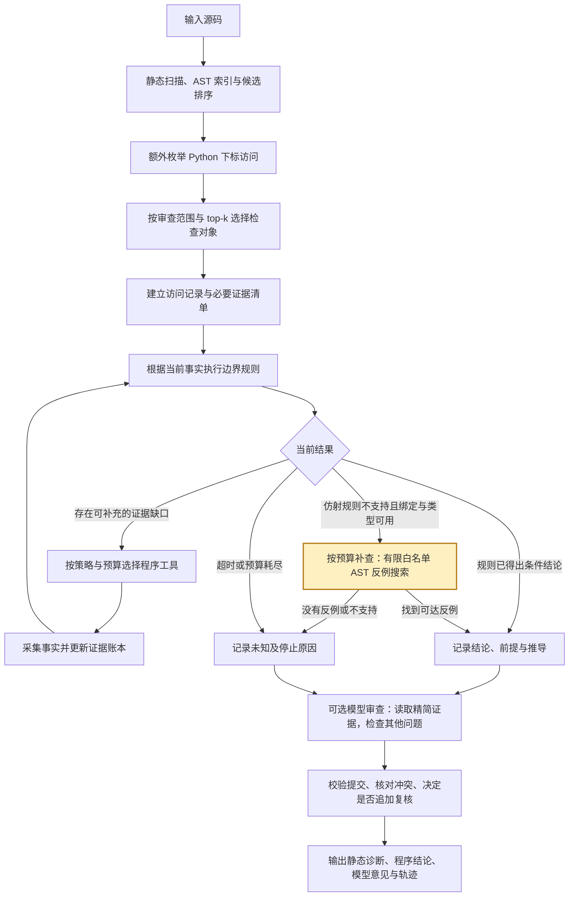
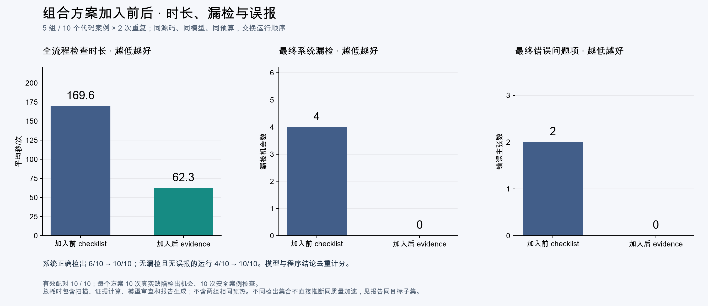

# 证据驱动程序分析整体设计

更新日期：2026-10-25。本文说明三个方案结合后的整体实现，以当前代码为准。

## 一、设计目标

在现有“静态扫描 → 候选排序 → 大模型审查 → 输出报告”的流程上，增加一条由程序执行的证据分析闭环：

**自动发现检查位置 → 明确判断所需事实 → 针对缺口补查 → 按规则验证 → 将结果交给模型补充审查 → 保留结论与依据。**

这样设计主要解决三个问题：扫描器没有报警的位置可能被漏掉；模型反复检查同一段代码但没有获得新信息；模型可能把安全访问报成错误，或者给真实错误写出不正确的触发条件。

首期针对 Python 普通列表的下标越界实现。其他语言和错误类型继续使用现有静态扫描与模型审查能力。

## 二、整体流程



黄色节点为本轮新增的有界反例补查；其余节点为已存在的组合方案闭环。

证据分析在模型调用前由程序完成，不依赖模型先决定调用哪个工具。不启用模型时，也能输出规则结论、证据缺口和分析轨迹；启用模型后，模型继续检查规则尚未覆盖的问题。

## 三、如何实现

### 1. 主动建立检查对象，减少入口漏检

原有静态诊断、AST 索引和可选 SBFL 排序继续保留。SBFL 需要测试通过/失败及覆盖数据，只负责提供可疑位置与排序线索，不能单独证明某行存在缺陷。

启用 `evidence` 策略后，程序额外枚举能够正常解析的 Python 文件中的下标访问。即使没有静态报警，也可以建立候选检查项。枚举到访问不代表已经具备判定能力，不支持的访问仍会保留未知结果。

每处访问记录文件、源码范围、表达式、源码哈希和 `access_id`。ID 关联当前源码版本和具体访问，使同一行的不同访问能够分别追踪。之后按审查范围和 `top-k` 选择实际检查对象，并报告未选择的数量。

**目的与效果：** 检查入口不再完全依赖扫描器是否报警，同时明确本次覆盖了哪些位置，避免把未检查误认为没有问题。

### 2. 用证据账本管理判断依据

对每处访问，程序按规则维护以下必要事实：

| 事实 | 需要确认的内容 |
| --- | --- |
| 名称绑定 | `len`、`range` 等是否仍按标准内置语义使用 |
| 容器 | 是否可按普通列表处理，是否知道初始长度 |
| 索引与循环范围 | 循环变量取值、整数偏移或常量索引 |
| 保护条件 | 分支是否阻止越界访问 |
| 修改与调用影响 | 容器是否被修改、调用是否可能影响判断 |
| 可达性 | 是否存在未支持的控制流或更早的阻断语句 |

事实附带来源、适用假设、访问 ID 和源码哈希。账本只接收匹配当前源码和访问的程序分析事实，模型意见不能直接写成已经验证的事实。事实变化时，依赖它的旧结果失效，需要重新计算。

类型注解也作为前提处理。例如参数标注为 `list`，不代表程序已经执行并确认运行时类型。

**目的与效果：** 让“为什么得出结论”和“缺少什么信息”都有具体记录，避免模型猜测与程序事实混用。

### 3. 按证据缺口选择补查动作

验证器每次返回当前结论或缺失事实。仍有可处理缺口时，调度器选择下一项程序动作，采集后再次验证。

这里的工具主要是项目自己实现的 AST 局部分析函数，例如提取循环范围、检查保护条件、查找列表修改操作、分析同文件辅助函数。现有静态扫描器仍提供独立诊断；模型另可通过 `read_lines`、`get_function` 等工具读取源码上下文。当前闭环没有接入外部文档检索。

补查策略提供 `rules`、`fixed`、`gaps`、`cost` 四种模式：分别用于不追查辅助函数的局部规则、固定顺序、缺口顺序和按权重/成本排序的启发式调度。`cost` 的成本是相对权重，不是实测秒数或 Token 价格。

该设计参考主动特征获取（AFA）对已有信息、未观测信息与获取成本的组织思想。Li 和 Oliva 的 [Active Feature Acquisition with Generative Surrogate Models](https://proceedings.mlr.press/v139/li21p.html)（ICML 2021，PMLR 139: 6450–6459）利用生成代理模型估计信息获取收益；Valancius、Lennon 和 Oliva 的 [Acquisition Conditioned Oracle for Nongreedy Active Feature Acquisition](https://proceedings.mlr.press/v235/valancius24a.html)（ICML 2024，PMLR 235: 48957–48975）提出 ACO，考虑联合有用的特征获取。

本项目将未观测特征对应为判断边界所需的程序事实，通过验证器返回的缺口驱动补查。当前 `cost` 仅按手工权重与相对成本选择下一项动作，没有实现上述论文的 GSM、学习式收益估计或 ACO 非贪心策略，不能将其表述为这两篇论文的算法复现；现有实验也不证明成本策略最优。

不同访问轮流取得补查机会。程序控制总动作数、相对成本预算和时间上限；遇到仿射规则不支持时，可补充一次有界反例搜索；工具不支持或预算限制时停止，写明原因，不将未知升级为安全。

**目的与效果：** 将“再检查一次函数”变成“补齐影响当前判断的具体事实”，减少重复分析。当前没有学习式收益预测、多步动作搜索或跨运行持久缓存，不能将其表述为已实现的优化。

### 4. 在支持范围内执行程序判定

规则首先支持普通列表、单步 `range(len(a) - c)`、循环变量加整数偏移或常量索引、直接上下界保护、上下界的链式/合取比较、只包含 return/continue 的简单提前退出，以及单生成器列表推导式。判断依据为：

```text
列表长度为 n，下标为 k：
合法范围为 -n <= k < n
```

程序综合循环范围、长度、保护条件和副作用事实，产生以下结果：

| 结果 | 含义 |
| --- | --- |
| `SAFE` | 在列出的前提下，该访问满足边界要求 |
| `VIOLATION` | 在列出的前提下，存在违反边界的符号见证或受控 AST 路径见证 |
| `UNDECIDED` | 尚缺必要事实，或结构超出支持范围 |

同时记录 `assumptions`、`missing`、`derivation`、`witness` 和 `stop_reason` 等信息。当前确定结论仍按 `conditional_safe` / `conditional_violation` 标注。

保护必须在循环变量绑定后对当前访问有效；循环外使用旧索引的条件不能作为循环内保护。仿射分析不接受条件表达式、不可达访问和容器重绑定的简单证明；有限路径搜索重新核对实际执行顺序，禁止跳过未知操作或更早的异常。

仿射规则无法处理、但入口绑定和普通列表类型前提可用时，补查器使用 `counterexample` 动作：只解释白名单 AST 的普通列表/整数语义，支持 pop/append、别名、同文件 helper、嵌套和多参数 range、乘法、分支与提前退出。禁止执行目标源码、任意导入或未知回调；生成器函数不按立即调用解释。解析后额外编译验证上下文合法性，仅生成并丢弃代码对象，不执行代码。`rules` 模式在所有补查入口禁用辅助函数，防止经反例搜索绕过消融开关。入口列表长度 0–8、整数 -2–8，最多 256 组输入、每组 3000 步、总计 100000 步、深度 4；相对成本为 8。**只用找到的可达越界证明存在风险，搜索失败绝不证明安全。** 这是解决副作用、复杂下标和失效保护漏检的补充能力，有限输入之外仍可能漏检。

见证记录 `entry_inputs`、访问时 `length/index`、整数局部变量和路径。特别是 pop 后长度与入口长度分开，避免错误触发条件。符号或有界 AST 见证都不是执行目标源码后复现异常。一个访问安全，也不能据此证明整个函数安全。切片、复杂别名、未知副作用、复杂控制流等未支持情形保留未知，不套用简单列表索引规则。

**目的与效果：** 将可以机械计算的边界判断交给程序，提高一致性，同时把能力边界暴露出来。

### 5. 让模型补充审查，并约束结论合并

程序结果作为精简证据发送给模型，完整事实账本保存在报告中。能够与既有循环下标审查单元唯一匹配的程序结论，由程序记录完成；模型仍要检查函数中的名称、类型、运算、状态和安全等其他问题。

模型新增问题使用 `issue_kind` 标明性质。越界问题通过 `access_id` 绑定具体访问，其他问题不绑定边界结论。提交还需通过源码位置和引用校验，但引用存在仅证明读取了对应位置，不能证明推理正确。

当前对模型意见的处理规则是：

- 只有源码哈希有效、程序已终止并解决、访问 ID 和文件行号匹配的列表边界意见，才允许自动校正。
- 同一访问的 `SAFE` 证据可移除对应越界误报；同一行的其他问题继续保留。
- `VIOLATION` 有符号或受控 AST 路径见证时，用该见证规范触发条件，标记 `evidence_origin=program_verified`，保留原始模型意见；路径见证区分入口参数和访问时状态。
- 未绑定、未知或过期证据不触发自动删除，继续保留意见与复核路径。
- 程序验证支持的风险不能被模型撤回；撤回理由写着“仍有效”“无需撤回”等矛盾操作也会被拦截并留痕。

当本次访问证据均已解决时，追加复核集中于未完成、待确认和未经程序验证的问题，避免重复计算已完成的边界任务。没有可用证据或仍存在未知访问时，保留原有追加复核逻辑。

**目的与效果：** 保留模型对开放问题的分析能力，减少边界误报、错误触发条件和真实问题被误撤回的情况；程序校正后的正确结论属于程序参与的结果，不能当成模型独立能力提升。

### 6. 输出可追踪的报告

报告分别展示静态诊断、程序条件结论和模型意见，不要求三者给出相同数量的问题。模型问题数也不等于最终系统缺陷总数。

主要输出包括：

| 内容 | 用途 |
| --- | --- |
| `report.html` / `report.json` | 阅读结果，保存完整事实、推导、覆盖范围与停止原因 |
| `program_analysis.trace` | 查看程序补查动作、选择理由和实际耗时 |
| `audit.program_reconciliations` | 查看模型原意见及程序校正依据 |
| `audit.blocked_withdrawals` | 查看被拦截的矛盾撤回 |
| `model-trace.jsonl`（启用模型时） | 查看模型交互过程 |
| `stage_timings` / `model_request_metrics` | 区分扫描、证据分析、模型处理和生成耗时 |

**目的与效果：** 能追踪问题从哪里产生、为什么被保留或移除，以及时间主要花在哪里。

## 四、一个完整例子

```python
def neighbors(values: list):
    for i in range(len(values)):
        item = values[i + 1]
```

程序先发现 `values[i + 1]`，再收集列表前提、内置名称绑定、循环范围、保护条件和副作用等事实。

在普通列表、标准内置函数、长度不变且访问可达的前提下，长度为 n 的非空列表，最后一次 i 为 n−1，访问索引 i+1 为 n，违反 `k < n`。程序输出带前提的 `VIOLATION`，并记录长度、循环变量和索引的符号见证。空列表时循环不执行，不应仅因没有额外空输入分支就报错。

如果增加直接保护：

```python
def neighbors(values: list):
    for i in range(len(values)):
        if i + 1 < len(values):
            item = values[i + 1]
```

在规则支持的前提下，保护条件阻止正向越界，程序可给出 `SAFE`。若模型仍把同一访问报为越界，系统按匹配证据校正并保留原意见。

如果循环中加入未知的 `update(values)`，程序会尝试补查调用影响。仿射证明只认证非常有限的同文件无副作用辅助函数；可解析的修改可进一步搜索路径反例，无法确定的调用保留 `UNDECIDED`，不假设列表长度不变。

## 五、代码落点

| 文件 | 当前职责 |
| --- | --- |
| `src/evidence_review/knowledge/__init__.py` | 定义缺陷规则及必要事实种类 |
| `src/evidence_review/knowledge/python_subscript.py` | 提取访问、采集局部事实、执行边界规则 |
| `src/evidence_review/knowledge/python_witness.py` | 在白名单语义与预算内搜索可达反例，记录入口和路径；搜索失败不证明安全 |
| `src/evidence_review/evidence.py` | 证据账本、补查调度、预算、轨迹和模型证据精简 |
| `src/evidence_review/audit.py` | 审查单元、结果校正、撤回约束与追加复核 |
| `src/evidence_review/agent.py` | 模型调用、工具协议、提交校验和请求度量 |
| `src/evidence_review/cli.py` | 组织流程、选择范围和记录阶段耗时 |
| `src/evidence_review/report.py` | 展示结论来源、证据与未完成事项 |

当前知识规则通过 Python 代码实现，尚未建立通用规则描述语言。扩展新语言或新缺陷类型，需要实现对应提取、事实采集和判定规则，并补充独立测试。

## 六、预期效果与验证

### 验证口径

准确性与效率分别评价：

- **准确性：** 比较最终正确检出、漏检和误报，逐条核对错误类型与触发条件。同一缺陷由程序与模型重复发现只计一次；程序正确不能抵消仍保留的模型错误主张。
- **效率：** 记录全流程耗时、模型请求轮数、Token 和程序补查成本。只有正确检出相同目标时，才能解释为同等检测效果下的提速。实验全流程使用外部墙钟计时，不能只统计模型时间。

主实验比较同一当前版本的 `checklist` 与 `evidence` 开关，固定源码、标签、模型、上下文容量和预算，交替执行顺序。两组共享基础修复，因此属于新增功能开关对照，不是两个历史版本的复刻。标签不发送给模型，准确性需要逐条语义裁决，不能仅按报警行号匹配。

补充策略实验比较 `rules/fixed/gaps/cost` 在相同输入与预算下的表现。它们均使用知识规则和验证器，只能解释局部补查策略的差异，不能代替三个组件分别移除的完整消融，也不能单独证明每个组件的贡献。当前成本启发式没有稳定优于缺口顺序的证据。

### 已有验证结果

已有五组 Python 边界用例，每组一个真实缺陷和一个安全对照，每组双重复，共 20 次真实分析。相同 `qwen3:8b`、40960-token 上下文、最多 4 轮请求的此前优化批次结果如下（新修复后的复测另列，不混用）：

| 指标 | checklist | evidence |
| --- | ---: | ---: |
| 最终正确检出 / 真实缺陷机会 | 6 / 10 | 10 / 10 |
| 最终漏检 | 4 | 0 |
| 最终误报问题项 | 2 | 0 |
| 全流程平均耗时（秒/次） | 125.95 | 41.73 |
| 模型请求总数 | 22 | 16 |

两组最终检出相同真实问题的 6 对子集，平均耗时为 176.15 → 42.07 秒；该子集属于探索性观察。本批结果支持在当前回归集上减少漏检、误报和重复工作，不能外推为所有项目都无误报或都能达到相同提速。

原始报告、逐条裁决、图表和代码示例见 [此前优化批次报告](../test/results-optimized-comparison/summary.md)。已有完整回归记录为 207 项通过。真实运行后增加的保守回退，通过同批真实提交逐轮回放验证；回放属于协议回归，不算新的模型实验。

## 七、运行入口与当前限制

从项目根目录运行，无模型也能检查：

```bash
.venv/bin/python -m evidence_review analyze test/cases/evidence_bounds/model_smoke.py \
  --analysis-strategy evidence --evidence-policy cost --review-scope files \
  --output reports/evidence-bounds
```

需要模型补充审查时，增加 `--model qwen3:8b`、实际服务地址 `--ollama-url`，并按机器容量设置 `--model-context`。默认策略仍为 `checklist`，必须显式启用 `evidence`。

运行补查策略实验和回归测试：

```bash
.venv/bin/python test/run_evidence_ablation.py --budgets 80 140 200 --output test/results-evidence-ablation-recheck
.venv/bin/python -m pytest -q
```

Windows 使用 `.\.venv\Scripts\python.exe` 替换 `.venv/bin/python`，多行命令合并为一行。完整安装、模型启动、主实验和裁决命令见 [README](../README.md)。重跑实验使用新的输出目录，保留原始记录。

目前需要明确的限制：

- 程序验证只覆盖有限 Python 列表边界结构；其他语言的扫描能力不等于已经接入同样的证据验证。
- Python 语法解析失败时记录错误，不基于恢复后的语法树生成确定性边界证明。模型仍可阅读原始源码给出带前提的意见。
- 知识库未覆盖的错误、复杂调用、别名和控制流仍可能漏检或无法判断。
- `top-k`、证据预算和模型预算都会限制覆盖，未选择或未完成的部分不能视为安全。
- 当前实现没有运行缺陷用例来复现符号见证，也没有证明该组合在已有研究中首次提出；方法价值需要靠清晰的实现边界和对照实验支撑。

## 八、扩展可靠性回归

新增 `test/cases/evidence_bounds/reliability/` 覆盖 4 类文件、37 个目标函数、40 处访问；独立标签区分真实语义与当前规则能力。冻结修改前的规则和调度模块实际重跑同一最终输入后，完整策略的真实危险检出 / 漏检从 5 / 10 变为 15 / 0，安全访问误报 3 → 0，危险误判安全 1 → 0。完整策略当前为 15 处风险、13 处条件安全和 12 处未知。

10 处原漏检分别涉及直接/辅助函数/别名缩短列表、嵌套循环、非线性下标、步长循环、无效条件、退出前访问和两种循环前旧索引保护。均已通过可达反例补齐。剩余 12 处未知包括 6 处安全但未获证明、3 处外部条件依赖、3 处类型越界规则以外的问题；不能用有限搜索将它们改成安全。局部 `rules` 禁用辅助函数补查，单独仍有 1 处漏检，其余三种策略检出全部 15 处；不能据此宣称完整组件消融已完成。

完整工程测试 290 项通过，包括 1512 个保护模板、98 个有界路径模板的原生 Python 独立语义验证、动态调用与提前异常、预算及验证开关、同位置不同性质问题保留。测试不执行缺陷文件，原生执行仅用于自己生成的受控模板。离线结果见 `test/results-evidence-reliability/summary.md`，不与模型准确率混计。

五组真实模型前后对照须先通过这批可靠性前置检查；已知漏检/误报未修好就拒绝启动。正式运行冻结代码，保留完整结果与人工逐项语义裁决，严格区分自然完整运行和记录回放。不能保证任意程序再无问题，也不能把这批人工用例的零漏检外推到真实项目。


## 九、代码与验证变更记录

2026-10-25 更新；后续代码与验证结果继续在本节及下一节同步，不另建重复文档。

| 文件/区域 | 变更与目的 | 验证 |
|---|---|---|
| `knowledge/python_subscript.py` | 保护条件必须对当前索引有效；拒绝失效保护和不支持的简单证明；先验证语法上下文合法性；为未解决访问提出 counterexample 缺口 | 保护模板、不可达语句、非法 break/continue/nonlocal、循环前旧变量保护 |
| `knowledge/python_witness.py` | 白名单解释普通列表/整数路径，保留别名与修改；只输出存在性反例；生成器、未知调用和不支持结构回退 | 98 个受控路径模板与原生 Python 对照、每条反例重放、安全/提前异常/动态 helper 对照 |
| `evidence.py` | 反例动作计入预算和账本；rules 所有路径禁用 helper；预算或关闭验证时不能抑制模型 | 四策略、动作/成本耗尽、验证开关、fallback 不绕过 rules |
| `audit.py`、`report.py` | 区分符号与 AST 路径见证；分别显示入口参数和访问时长度；只校正对应边界属性 | pop 后长度报告、同行多访问与其他问题保留 |
| `test/cases/evidence_bounds/reliability/` | 4 类文件、40 处独立语义标注，缺陷/安全/条件依赖/类型问题分别计分 | 源码摘要和访问行列校验；未知不计检出 |
| `test/run_comparison_matrix.py` | 正式实验前禁止已知漏检/误报进入对照；运行期间验证源码、用例、模型摘要 | 四种质量门槛失败均阻止启动；正式结果保存实际前置检查与版本摘要 |

完整 pytest 为 290 项通过，真实扫描器和 CLI 回归全部完成。离线报告见 [规则修复验证](../test/results-evidence-reliability/summary.md)。

对照处理遵循下表，避免比较不一致的基础版本：

| 变更性质 | checklist 对照组 | evidence 实验组 |
|---|---|---|
| 与方案无关的公共修复 | 使用当前已修复代码 | 使用相同已修复代码 |
| 新增知识规则、反例搜索、证据调度和属性校正 | 关闭 | 启用当前改进后的实现 |
| 报告文案、实验前置检查与计时记录 | 使用当前版本 | 使用相同版本 |

“代码冻结”只表示一轮实验期间保持分析器版本一致，不表示沿用旧代码。每次新修复先加入适用的两组，通过回归后再开始正式运行。旧规则模块的离线对比仅验证本次规则修复，不能替代方案开关对照。

正式模型对照已全部完成，逐条语义裁决和新指标见下一节；中止批次的部分数据不参与统计。

复测操作（从项目根目录执行；输出到新目录，避免覆盖原始记录）：

```bash
# 规则可靠性回归，不调用模型、不执行缺陷文件
.venv/bin/python test/run_evidence_reliability.py --output test/results-evidence-reliability-new

# 正式模型对照，先自动运行可靠性前置检查
.venv/bin/python test/run_comparison_matrix.py \
  --model qwen3:8b --ollama-url http://127.0.0.1:11435 \
  --model-context 40960 --repeats 2 --max-rounds 4 \
  --output test/results-reliability-comparison-new

# 逐条核对并填写新目录 adjudication.json 后生成报告
.venv/bin/python test/plot_comparison_matrix.py \
  --output test/results-reliability-comparison-new --require-no-regression
```

服务地址、模型容量和中文字体按本机设置；Windows 命令替换方法见第七节。人工裁决不能用行号匹配代替，所有 pending 必须处理后才能生成完整效果图。

历史规则修复前结果及模块摘要保存在离线 summary.json；本轮修改前源码保存在 `evidence-reliability.patch` 的旧侧，不依赖临时目录长期存在。若需重跑该离线基线，应在独立副本只还原 `knowledge/python_subscript.py`、`knowledge/__init__.py`、`evidence.py` 三个模块并保持当前40处用例与标签。正式 checklist/evidence 对照直接运行当前源码的开关，不需要还原旧模块。


## 十、修复后的正式对照复测

使用本轮完整修复后的同一源码，checklist 关闭方案、evidence-cost 开启方案；公共修复两组共享。五组、每组双重复、20次真实模型分析均完成且上下文有效。模型 qwen3:8b、上下文40960、温度0、最多4轮，AB/BA交替；逐条人工语义裁决，未盲评，程序与模型重复检出去重。完整 pytest 为290项通过，前置可靠性门槛通过后才启动本批。

| 指标 | 方案关闭 | 方案开启 |
|---|---:|---:|
| 最终正确检出/10次机会 | 6 | 10 |
| 最终漏检 | 4 | 0 |
| 最终误报问题项 | 2 | 0 |
| 无漏检且无误报的运行/10 | 4 | 10 |
| 平均完整耗时/秒 | 169.61 | 62.27 |
| 模型请求总数 | 22 | 18 |

最终检出同一真实问题的 6 对探索性子集，完整平均耗时 233.37 → 62.92 秒，请求总数 12 → 10。它不是首次检出时间，也不是所有质量维度完全相同的严格等质量基准；最终误报另行统计。

本批原五组触发新增反例搜索 0 次，主要检验既有组合方案在修复后是否保持收益；不能将全部收益归因本轮新模块，更不能声称四种策略已证明三个组件各自贡献。15/15复杂边界检出来自独立扩展集，二者不混计。

完整结果、代码示例、模型原意见和程序校正见 [复测报告](../test/results-reliability-comparison/summary.md)，逐条裁决见 [adjudication.json](../test/results-reliability-comparison/adjudication.json)，源码/模型摘要和测量见 [summary.json](../test/results-reliability-comparison/summary.json)。本轮只保留必要报告、原始运行及一份独立 patch，临时输出清理。



耗时主要由模型请求与生成构成，具体分段值见报告。减少已验证边界的重复模型任务、精简输入及由未决任务驱动思考模式共同影响耗时；请求数没有减少的配对不能说成轮数减少。小型人工Python边界集和两次重复不能外推任意项目零误报/零漏检或统计显著加速。


### 本轮三项变化的依据

| 指标 | 已核对原因 | 证据 |
|---|---|---|
| 漏检 4→0 | offset 与 negative 各两次基线最终错误撤回真实风险；开启方案后程序见证保持有效，不允许模型把已验证风险撤回 | 原始 trace、最终 findings 和逐条裁决；不是靠报警行号评分 |
| 误报 2→0 | guard 的安全访问已有 i+1<n 保护，基线两次仍报末轮越界；实验组按该访问的 SAFE 证据移出边界误报 | 两次 program_reconciliations 保留模型原意见、access_id 和安全依据；不移除同行其他性质问题 |
| 耗时下降 | 已完成边界任务由程序承担，减少重复复核和重复思考；完整请求22→18，生成Token18664→5982 | 服务生成耗时1523.35→471.94秒；输入处理161.67→142.07秒；模型请求占总耗时均约99%，证据分析累计仅0.0154秒 |

helper 两次完整轮次均为2→1；guard 与 local 均为2→2，二者的提速主要体现在单次请求生成负担下降，不能统一表述成轮次减少。开启思考的请求从12→0，是当前这批边界任务均已解决后的协议选择；遇到未知边界仍保留思考。未单独禁用各优化项，不能将总加速严格分摊给某一个组件。


归档校验已完成：`git apply --check --reverse evidence-reliability.patch` 通过；在自动清理的独立临时副本还原三个旧模块后，3/3 SHA-256 与离线基线记录一致。正式矩阵20/20完整且上下文有效，质量门槛全通过，分析器及实验脚本摘要与运行开始时一致。图表已逐张检查。临时脚本、CLI中间输出和工作快照在交付前清理；原始正式运行与一份独立patch保留。


### 汇报报告同步记录

2026-10-25 已覆盖更新 `docs/程序分析工具汇报报告.docx`。第六至九部分的总指标、分组耗时、相同真实目标效率、Token与服务分段耗时、图3和最终结论均采用 `test/results-reliability-comparison/summary.json` 的20次有效真实复测；旧批次只作为明确标注的历史背景。同步补充290项回归、40处访问的独立可靠性结果，以及新增反例搜索在原五组中调用0次的归因限制。

汇报报告保持原有9部分结构和9页排版，逐项核对数值与内嵌图摘要，使用内置LibreOffice指定现有中文字体渲染，并逐页检查中文、表格、图表和分页。本次为已有实测结果的文档同步；过程中的副本、PDF和页面图片只作临时排版验证，交付后清理。
