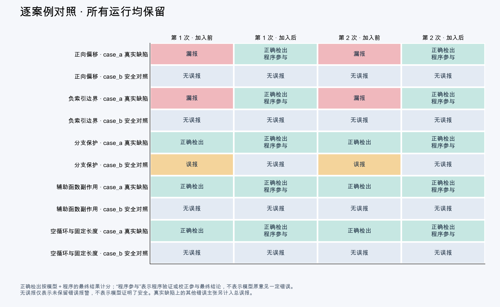

# 多组前后对照结果与代码示例

固定 5 组、10 个代码案例，每组重复 2 次，共 20 次分析运行。真实模型 qwen3:8b，上下文 40960，温度 0。
同一当前代码版本的 checklist / evidence 开关对照，保留共同缺陷修复；不是两个历史版本。每对同源码、模型和轮次预算，AB/BA 交替，不按结果筛选重复。
标签事先保存在 manifest.json，没有发送给模型。普通内置 list 与标准 len/range，无并发修改；评分 IndexError，空输入无操作是允许行为。安全样例的空路径/返回 None 不需要额外业务处理。
助手逐条核对原始结论，未盲评；程序与模型重复检出按独立缺陷去重；SAFE 不抵消仍保留的模型错误主张，程序校正须有明确记录。
严格正确性口径：触发条件明确错误的模型意见不计正确检出，即使报警位置碰巧是真实缺陷；它计入错误主张。安全说明误列入正式 findings 也计误报。程序的正确见证仍独立计分。修复建议不作为检测 TP 的充分条件，也未经自动修复验证。

本批有效配对中，系统正确检出由 **6** 变为 **10**，最终误报问题项由 **2** 至 **0**（减少）。不能只凭个别误报被撤回就宣称总体误报改善。

| 指标 | 加入前 | 加入后 |
|---|---:|---:|
| 最终正确检出 / 真实缺陷机会 | 6 / 10 | 10 / 10 |
| 全流程平均耗时（秒/次） | 169.61 | 62.27 |
| 最终漏检 | 4 | 0 |
| 无漏检且无误报的完整运行 | 4 / 10 | 10 / 10 |
| 最终误报问题项 | 2 | 0 |
| 其中：错误触发条件 | 0 | 0 |
| 其中：安全说明误列问题 | 0 | 0 |
| 其中：安全访问被断言为越界 | 2 | 0 |
| 安全案例被误报 / 安全检查机会 | 2 / 10 | 0 / 10 |

逐对变化：新增正确检出 **4** 次，反向漏报 **0** 次；原误报消失 **2** 项次，同时新增误报 **0** 项次。不能只列减少的一侧。




## 最终系统结果的判定口径

最终系统结果合并程序验证与模型最终保留的结论，同一真实缺陷只计一次；正确与否由预先登记的标签和逐条人工裁决判断。未经程序改写的模型检出仅用于解释来源；程序校正条目归入程序来源，不能用该计数升降判断模型能力。这是实验的综合计分；当前自动校正只覆盖已支持的列表边界属性，其他或未知意见仍需复核。
“无漏检且无误报的完整运行”要求该次运行检出所有已标注真实缺陷，且没有任何计分范围内的错误问题项；分母是每个方案的有效完整运行次数。它反映本测试集上的整次运行正确性，不能解释成一般项目准确率。
正确检出按缺陷计数，错误问题项按错误主张计数，两者不能直接相加当作总问题数计算精确率。重复两次增加的是检出机会，不是独立缺陷数量。

## 各组最终系统结果（2 次重复累计）

| 用例组 | 加入前：正确 / 漏检 / 错误项 | 加入后：正确 / 漏检 / 错误项 | 无漏检且无误报的运行：前 → 后 |
|---|---:|---:|---:|
| 正向偏移 | 0 / 2 / 0 | 2 / 0 / 0 | 0/2 → 2/2 |
| 负索引边界 | 0 / 2 / 0 | 2 / 0 / 0 | 0/2 → 2/2 |
| 分支保护 | 2 / 0 / 2 | 2 / 0 / 0 | 0/2 → 2/2 |
| 辅助函数副作用 | 2 / 0 / 0 | 2 / 0 / 0 | 2/2 → 2/2 |
| 空循环与固定长度 | 2 / 0 / 0 | 2 / 0 / 0 | 2/2 → 2/2 |

## 检查时长与慢因定位

全流程计时包含索引、静态扫描、证据补查、全部模型轮次和报告生成；每次相同的单 Token 预热排除在计时外。成功与失败的模型尝试均计入，输入超限或未完成运行不进入有效配对。

| 指标 | 加入前 | 加入后 |
|---|---:|---:|
| 总耗时（秒） | 1696.13 | 622.68 |
| 平均耗时（秒/次） | 169.61 | 62.27 |
| 中位耗时（秒/次） | 155.88 | 63.18 |
| 模型请求/轮次总数 | 22 | 18 |
| 模型请求耗时（秒） | 1688.23 | 615.34 |
| 其余耗时（秒） | 7.90 | 7.34 |
| 输入 Token | 77430 | 74576 |
| 生成 Token（含服务计入的思考） | 18664 | 5982 |

### 服务分段耗时与输入负担（成功响应累计）

| 指标 | 加入前 | 加入后 |
|---|---:|---:|
| 有分段记录的请求数 | 22 | 18 |
| 请求体累计字节 | 510118 | 467960 |
| 开启循环边界思考的请求数 | 12 | 0 |
| 加载耗时秒 | 0.04 | 0.03 |
| 输入处理耗时秒 | 161.67 | 142.07 |
| 生成耗时秒 | 1523.35 | 471.94 |

模型请求占全流程耗时：99.5% → 98.8%。
索引/扫描/证据补查累计秒：前 0.021/7.749/0.0000；后 0.014/7.174/0.0154。
服务分段值来自 Ollama 成功响应的纳秒字段换算；与客户端墙钟不完全相等，不能重复相加到总耗时。未决边界任务仍保留思考模式，不能为了提速跳过未知问题。

### 每组全流程平均耗时

| 组 | 加入前秒/次 | 加入后秒/次 | 前/后请求数 |
|---|---:|---:|---:|
| 正向偏移 | 61.57 | 50.14 | 4 / 4 |
| 负索引边界 | 86.38 | 72.45 | 6 / 4 |
| 分支保护 | 348.21 | 82.77 | 4 / 4 |
| 辅助函数副作用 | 196.03 | 42.79 | 4 / 2 |
| 空循环与固定长度 | 155.88 | 63.18 | 4 / 4 |

### 检出相同真实问题时的全流程耗时

仅有效配对且两组最终正确检出集合相同、非空；比较完成全流程的耗时，不是首次检出时刻。不得外推整个缺陷集的同质量加速。
有效同目标配对 6 对；涉及组：guard、helper、local。
平均耗时 233.37 → 62.92 秒；变化 -73.0%；请求总数 12 → 10。
这是按最终真阳性交集条件选出的探索性子集，不能代替全体预先固定用例结果，亦不证明同目标首次检出的延迟。

### 本次修复与耗时优化

- 错误撤回：拦截“仍有效、无需撤回”等与撤回操作矛盾的提交；程序验证支持的边界风险不能被模型撤回。
- 安全说明误列问题：新增问题性质和访问 ID 绑定，仅对源码哈希匹配且终止为 SAFE/VIOLATION 的同一访问做属性级校正。SAFE 只处理该处边界意见，同一行其他缺陷保持审查。
- 错误触发条件：程序已判 VIOLATION 的同一边界属性，采用程序符号见证生成规范结论；模型原条件保留在程序校正记录中，不能冒充模型独立正确。
- 重复输入：模型只接收必要结论、前提、推导和缺项；完整事实账本、哈希与补查轨迹继续保存在报告，不在 audit_plan 中重复发送。
- 重复轮次：程序已经完成的循环边界任务不再让模型重新提交；函数其他性质仍须模型审查。完整且无冲突时结束，仅补查缺项、未决记录或未验证模型问题。
- 模型思考：仍存在未决循环边界任务时保留原思考模式；边界任务由程序完成后，其他任务使用既有非思考提交，减少重复边界推理。
- 新增分段计时：记录扫描、证据补查、审查、每轮请求大小及服务返回的加载/输入处理/生成耗时；不用推测代替实测。

### 质量门槛

本批最终漏检不劣化：True；最终错误问题项不劣化：True；没有新增错误主张：True。
此门槛仅适用于本回归集及评分范围，不能保证任意项目零误报。

## 每组变化与代码

TP 按真实缺陷去重；FP 按错误主张去重，包括错误触发条件。重复次数不等于独立案例数。

### 正向偏移（offset）

```python
def case_a(values: list[int]):
    return [values[i + 2] for i in range(len(values) - 1)]


def case_b(values: list[int]):
    return [values[i + 2] for i in range(len(values) - 2)]
```

- `case_a`：真实缺陷。n>=2 时最后一次 i=n-2，i+2=n 越界；最小示例 [0,1]。
- `case_b`：安全对照。n<=2 时不访问；n>=3 时最大 i+2=n-1，合法。

| 重复 | 加入前 TP / FP | 加入后 TP / FP | 新增检出 | 消失的错误主张 | 新增错误主张 |
|---|---|---|---|---|---|
| 1 | 0 / 0 | 1 / 0 | ['case_a'] | [] | [] |
| 2 | 0 / 0 | 1 / 0 | ['case_a'] | [] | [] |
- [offset/01-checklist 原始报告](offset/01-checklist/report.html)；完成=True，上下文有效=True。
- [offset/01-evidence 原始报告](offset/01-evidence/report.html)；完成=True，上下文有效=True。
- [offset/02-evidence 原始报告](offset/02-evidence/report.html)；完成=True，上下文有效=True。
- [offset/02-checklist 原始报告](offset/02-checklist/report.html)；完成=True，上下文有效=True。

### 负索引边界（negative）

```python
def case_a(values: list[int]):
    return [values[i - 2] for i in range(len(values))]


def case_b(values: list[int]):
    return [values[-1] for i in range(len(values))]
```

- `case_a`：真实缺陷。n=1 时 i=0，下标 -2 小于合法下界 -1；n>=2 则均合法。
- `case_b`：安全对照。n=0 时不执行；n>=1 时 -1 是合法末元素索引。

| 重复 | 加入前 TP / FP | 加入后 TP / FP | 新增检出 | 消失的错误主张 | 新增错误主张 |
|---|---|---|---|---|---|
| 1 | 0 / 0 | 1 / 0 | ['case_a'] | [] | [] |
| 2 | 0 / 0 | 1 / 0 | ['case_a'] | [] | [] |
- [negative/01-checklist 原始报告](negative/01-checklist/report.html)；完成=True，上下文有效=True。
- [negative/01-evidence 原始报告](negative/01-evidence/report.html)；完成=True，上下文有效=True。
- [negative/02-evidence 原始报告](negative/02-evidence/report.html)；完成=True，上下文有效=True。
- [negative/02-checklist 原始报告](negative/02-checklist/report.html)；完成=True，上下文有效=True。

### 分支保护（guard）

```python
def case_a(values: list[int]):
    for i in range(len(values)):
        if i - 2 < len(values):
            _item = values[i - 2]


def case_b(values: list[int]):
    for i in range(len(values)):
        if i + 1 < len(values):
            _item = values[i + 1]
```

- `case_a`：真实缺陷。上界保护不保证负向下界；n=1、i=0 时 -2<1 成立但下标越界。
- `case_b`：安全对照。分支保证 i+1<n，且 i+1>=1；空列表不执行。

| 重复 | 加入前 TP / FP | 加入后 TP / FP | 新增检出 | 消失的错误主张 | 新增错误主张 |
|---|---|---|---|---|---|
| 1 | 1 / 1 | 1 / 0 | [] | ['guard.case_b.unreachable_last_iteration'] | [] |
| 2 | 1 / 1 | 1 / 0 | [] | ['guard.case_b.unreachable_last_iteration'] | [] |
- [guard/01-checklist 原始报告](guard/01-checklist/report.html)；完成=True，上下文有效=True。
- [guard/01-evidence 原始报告](guard/01-evidence/report.html)；完成=True，上下文有效=True。
- [guard/02-evidence 原始报告](guard/02-evidence/report.html)；完成=True，上下文有效=True。
- [guard/02-checklist 原始报告](guard/02-checklist/report.html)；完成=True，上下文有效=True。

### 辅助函数副作用（helper）

```python
def observe(values):
    pass


def case_a(values: list[int]):
    for i in range(len(values)):
        observe(values)
        _item = values[i + 1]


def case_b(values: list[int]):
    for i in range(len(values) - 1):
        observe(values)
        _item = values[i + 1]
```

- `case_a`：真实缺陷。observe 不修改列表；n>=1 最后一次 i+1=n 越界。
- `case_b`：安全对照。observe 无副作用；n<=1 不执行，n>=2 最大 i+1=n-1。

| 重复 | 加入前 TP / FP | 加入后 TP / FP | 新增检出 | 消失的错误主张 | 新增错误主张 |
|---|---|---|---|---|---|
| 1 | 1 / 0 | 1 / 0 | [] | [] | [] |
| 2 | 1 / 0 | 1 / 0 | [] | [] | [] |
- [helper/01-checklist 原始报告](helper/01-checklist/report.html)；完成=True，上下文有效=True。
- [helper/01-evidence 原始报告](helper/01-evidence/report.html)；完成=True，上下文有效=True。
- [helper/02-evidence 原始报告](helper/02-evidence/report.html)；完成=True，上下文有效=True。
- [helper/02-checklist 原始报告](helper/02-checklist/report.html)；完成=True，上下文有效=True。

### 空循环与固定长度（local）

```python
def case_a():
    values = [1]
    for i in range(len(values)):
        _item = values[-2]


def case_b():
    values = []
    for i in range(len(values)):
        _item = values[i + 1]
```

- `case_a`：真实缺陷。列表固定长度 1，循环执行一次，下标 -2 越界。
- `case_b`：安全对照。列表长度为 0，循环体不可达，不会访问 values[i+1]。

| 重复 | 加入前 TP / FP | 加入后 TP / FP | 新增检出 | 消失的错误主张 | 新增错误主张 |
|---|---|---|---|---|---|
| 1 | 1 / 0 | 1 / 0 | [] | [] | [] |
| 2 | 1 / 0 | 1 / 0 | [] | [] | [] |
- [local/01-checklist 原始报告](local/01-checklist/report.html)；完成=True，上下文有效=True。
- [local/01-evidence 原始报告](local/01-evidence/report.html)；完成=True，上下文有效=True。
- [local/02-evidence 原始报告](local/02-evidence/report.html)；完成=True，上下文有效=True。
- [local/02-checklist 原始报告](local/02-checklist/report.html)；完成=True，上下文有效=True。

## 程序属性校正的实际记录

下面记录模型原意见和程序处理。SAFE 仅处理对应访问的边界意见，VIOLATION 采用符号见证规范化条件；规范化数量不等于误报数量，正确与否仍逐条人工裁决。模型原文保存在各次报告的 audit.program_reconciliations 和 trace。

| 运行 | 原问题位置及标题 | 模型原触发条件 | 程序处理 |
|---|---|---|---|
| offset/01-evidence | offset.py:2 · 列表下标越界 | 当 len(values) <= 2 时，i + 2 会超出列表长度。 | 该访问有越界见证，条件由程序规范化 |
| offset/01-evidence | offset.py:6 · 列表下标越界 | 当 len(values) <= 2 时，i + 2 会超出列表长度。 | 该访问边界在前提下安全，移出问题清单 |
| offset/02-evidence | offset.py:2 · 列表下标越界 | 当 len(values) <= 2 时，i + 2 会超出列表长度。 | 该访问有越界见证，条件由程序规范化 |
| offset/02-evidence | offset.py:6 · 列表下标越界 | 当 len(values) <= 2 时，i + 2 会超出列表长度。 | 该访问边界在前提下安全，移出问题清单 |
| negative/01-evidence | negative.py:2 · 列表下标越界 | 当 len(values) < 2 时，i - 2 的值可能小于 -len(values)，导致越界访问。 | 该访问有越界见证，条件由程序规范化 |
| negative/01-evidence | negative.py:6 · 列表下标越界 | 当 values 为空时，values[-1] 会引发 IndexError。 | 该访问边界在前提下安全，移出问题清单 |
| negative/02-evidence | negative.py:2 · 列表下标越界 | 当 len(values) < 2 时，i - 2 的值可能小于 -len(values)，导致越界访问。 | 该访问有越界见证，条件由程序规范化 |
| negative/02-evidence | negative.py:6 · 列表下标越界 | 当 values 为空时，values[-1] 会引发 IndexError。 | 该访问边界在前提下安全，移出问题清单 |
| guard/01-evidence | guard.py:4 · 列表下标越界风险 | 当 i = 0 时，i - 2 = -2，此时 values[i - 2] 会访问到列表的 -2 索引，这在 Python 中是合法的，但可能超出预期范围。 | 该访问有越界见证，条件由程序规范化 |
| guard/01-evidence | guard.py:10 · 列表下标越界风险 | 当 i = len(values) - 1 时，i + 1 = len(values)，此时 values[i + 1] 会访问到列表的 len(values) 索引，这在 Python 中是非法的。 | 该访问边界在前提下安全，移出问题清单 |
| guard/02-evidence | guard.py:4 · 列表下标越界风险 | 当 i = 0 时，i - 2 = -2，此时 values[i - 2] 会访问到列表的 -2 索引，这在 Python 中是合法的，但可能超出预期范围。 | 该访问有越界见证，条件由程序规范化 |
| guard/02-evidence | guard.py:10 · 列表下标越界风险 | 当 i = len(values) - 1 时，i + 1 = len(values)，此时 values[i + 1] 会访问到列表的 len(values) 索引，这在 Python 中是非法的。 | 该访问边界在前提下安全，移出问题清单 |
| helper/01-evidence | helper.py:8 · 列表下标越界 | 当 values 的长度为 1 时，i + 1 会等于 len(values)，导致越界。 | 该访问有越界见证，条件由程序规范化 |
| helper/01-evidence | helper.py:14 · 列表下标越界 | 当 values 的长度为 1 时，循环不会执行，因此不会越界。 | 该访问边界在前提下安全，移出问题清单 |
| helper/02-evidence | helper.py:8 · 列表下标越界 | 当 values 的长度为 1 时，i + 1 会等于 len(values)，导致越界。 | 该访问有越界见证，条件由程序规范化 |
| helper/02-evidence | helper.py:14 · 列表下标越界 | 当 values 的长度为 1 时，循环不会执行，因此不会越界。 | 该访问边界在前提下安全，移出问题清单 |
| local/01-evidence | local.py:4 · 负索引访问可能导致越界 | 当 values 列表长度小于 2 时，访问 values[-2] 会越界。 | 该访问有越界见证，条件由程序规范化 |
| local/01-evidence | local.py:10 · 循环中访问 i + 1 可能越界 | 当 values 列表为空时，循环不会执行，但表达式 values[i + 1] 仍可能越界。 | 该访问边界在前提下安全，移出问题清单 |
| local/02-evidence | local.py:4 · 负索引访问可能导致越界 | 当 values 列表长度小于 2 时，访问 values[-2] 会越界。 | 该访问有越界见证，条件由程序规范化 |
| local/02-evidence | local.py:10 · 循环中访问 i + 1 可能越界 | 当 values 列表为空时，循环不会执行，但表达式 values[i + 1] 仍可能越界。 | 该访问边界在前提下安全，移出问题清单 |

## 误报是否由新方案纠正

上表的“错误主张消失”仅是最终输出差异。下面单列真实的程序冲突反馈与撤回记录；没有记录就不称为程序主动纠错。即使有纠错记录，若旧流程也撤回相同误报，就不能称为新增方案额外消除误报。

本批有直接属性校正记录，见上表；没有采用“反证反馈后让模型撤回”的旧机制，不能把两者混为一谈。

## 对结果的解释

- 公共修复进入两组，方案专属功能通过开关隔离；两组来自同一当前源码，不是历史提交还原。
- 本批开始前完整 pytest 290 项通过，真实 CLI 回归完成；可靠性前置检查为 40 访问、真实越界15/15，无安全误报或危险误判安全。
- 单独的规则修复前后结果是冻结旧规则/调度模块的离线重跑，不能替代本批 checklist/evidence 对照。
- 有限 AST 搜索的零漏检只限扩展集；当前12处UNKNOWN包括安全未证明、外部条件依赖和类型问题，不表示任意源码已无缺陷。
- 重复是检出机会，不是独立项目；耗时受本机运行状态和模型生成影响，跨批次差异不能单独归因某项修复。

## 限制与复现

这是小型、人工设计的 Python 列表边界回归集，覆盖首期验证器支持的结构；没有 SBFL，未执行目标源码。程序 SAFE/VIOLATION 是带前提的规则结论。不能推断一般项目、多语言或三个单独组件的收益。
同模型温度 0 的重复结果可能完全相同，不能把重复当作独立统计样本。准确性与耗时分开；同质量效率仅比较共同最终真阳性集合，不把漏检更多当作提速。纯风格和非目标意见保留在裁决中，不当作正确越界检出。
原始模型输出、扫描状态和调用轨迹在各运行目录；逐条裁决在 adjudication.json，汇总数字在 summary.json，源码标签在 test/cases/evidence_bounds/matrix/manifest.json。

```bash
.venv/bin/python test/run_comparison_matrix.py --repeats 2 --max-rounds 4 --output test/results-comparison-matrix-new
# 完成逐条语义裁决后，生成图表和文档：
.venv/bin/python test/plot_comparison_matrix.py --output test/results-comparison-matrix-new
```

## 本轮修复与对照版本核对

这轮在已知缺陷修好、290项 pytest 通过、真实扫描器/CLI 回归完成后重新运行。两次中止批次的部分数据已清理，没有混入20次正式运行。
两组使用同一当前代码：公共修复两组都有；知识规则、反例搜索、证据调度和属性校正由 evidence 开关控制。不是拿改进后的程序对比缺少公共修复的旧提交。每次运行前核对源码、用例和模型摘要；完整批次结束后再次核对源码一致。
扩展可靠性集的规则检出从5/15提升到15/15，程序安全误报3→0、危险误判安全1→0；这是冻结旧规则模块的离线修复比较，不是本批模型基线。
本批原五组实际 counterexample 动作数为 0。它们已有仿射规则可判，故这批复测检验的是原组合方案结论是否仍成立，不能将其加速全部归因本次新增的路径搜索。新增能力的具体价值由扩展集和原生语义回归支撑。

### 同一最终真实问题的轮次核对

| 组/重复 | 完整复核轮次：前→后 | 首次正确原始模型提交：前→后 | 实验组系统首次检出 |
|---|---:|---|---|
| guard/1 | 2 → 2 | 1 → None | 程序阶段0 |
| guard/2 | 2 → 2 | 1 → None | 程序阶段0 |
| helper/1 | 2 → 1 | 1 → 1 | 程序阶段0 |
| helper/2 | 2 → 1 | 1 → 1 | 程序阶段0 |
| local/1 | 2 → 2 | 1 → 1 | 程序阶段0 |
| local/2 | 2 → 2 | 1 → 1 | 程序阶段0 |

首次正确原始模型提交按逐轮人工语义裁决记录，None表示未提交符合口径的原始正确条件；程序校正后正确不补记为原始模型正确。程序阶段0在模型请求前，仍有扫描和证据计算成本。上述配对按最终真阳性集合相同选择，属于探索性子集，不保证每对最终误报集合也相同。
设计、代码变更、已知边界及验证入口同步见 docs/evidence-driven-analysis.md 和 docs/design.md；evidence-reliability.patch只包含本轮修改，未混入此前未提交变更。
